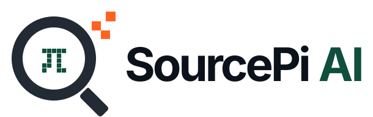
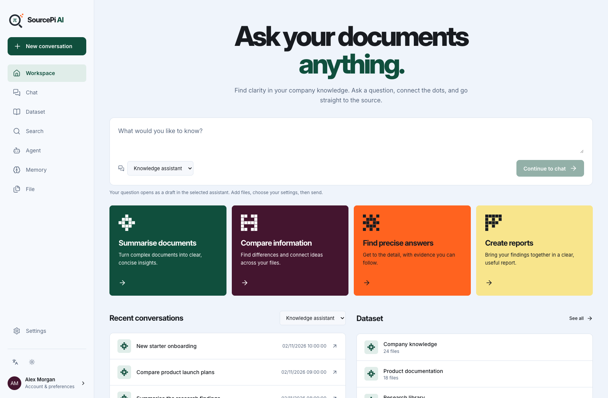
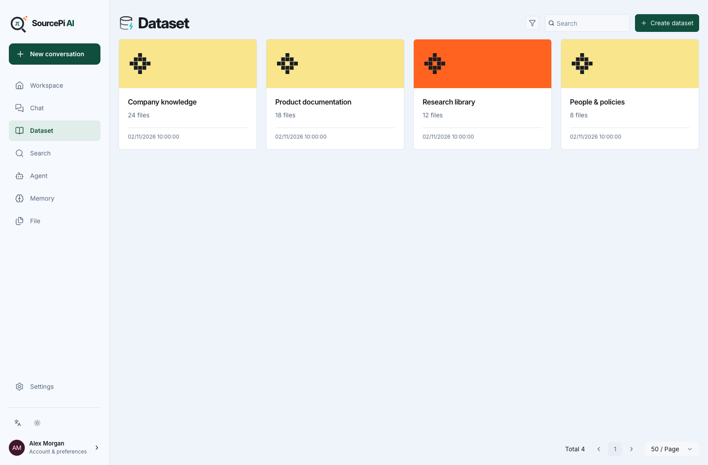
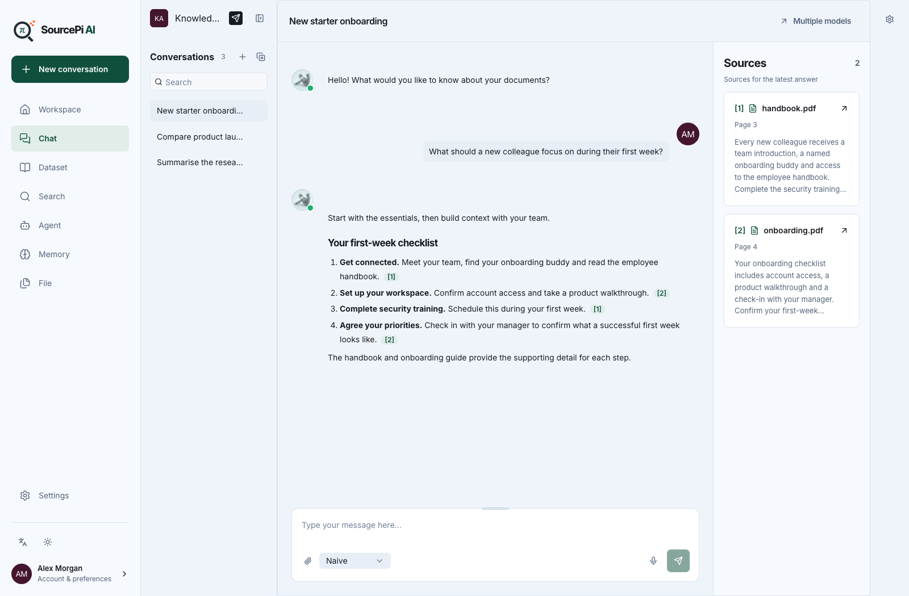
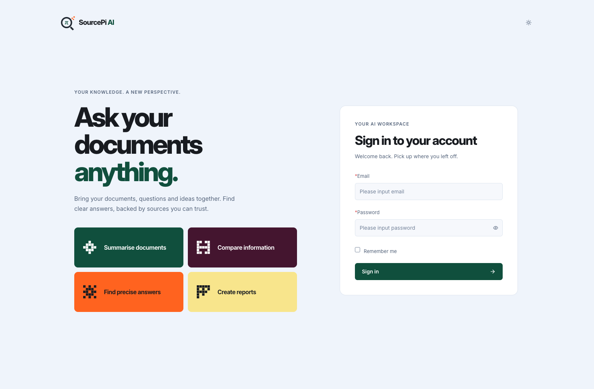
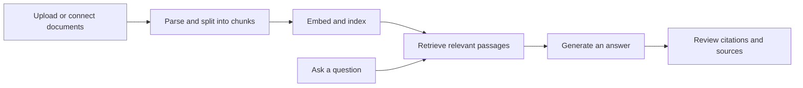
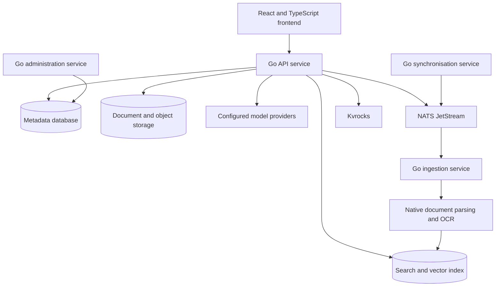

<p align="center">
  
</p>

<h1 align="center">Your documents. Clear answers. Sources you can check.</h1>

<p align="center">
  An AI workspace for turning documents into searchable knowledge, asking better questions,
  and following every cited answer back to its source.
</p>

<p align="center">
  <a href="#a-look-inside">Explore the workspace</a> ·
  <a href="#get-started">Get started</a> ·
  <a href="#how-it-works">How it works</a> ·
  <a href="#development">Development</a>
</p>



## What is SourcePi AI?

SourcePi AI brings your documents, knowledge bases, conversations and AI assistants into one workspace. Organise company knowledge, connect a model provider, and ask questions against the material you choose. Answers can include inline citations and a Sources panel with document names, page references and supporting excerpts.

Use it to understand research, find company policies, compare information across documents, or return to an ongoing conversation without starting again. You control the deployment, the knowledge you connect and the model providers you configure.

## A look inside

The following screenshots show the actual frontend with illustrative workspace data. Names, documents and the sample answer are demonstrations, rather than private workspace content or a live model response.

### Start with a question

The workspace puts the question input first. Choose an assistant, type a question, or use a prompt card to summarise documents, compare information, answer a specific question or draft a report. Recent conversations and knowledge bases stay within reach.

The prompt cards prepare your question; the selected assistant's model and connected datasets determine the answer.

### Organise your knowledge

Create datasets for different teams, topics or projects. Add documents, configure processing and retrieval, and keep track of the files available to each assistant.



### Read the answer and check the evidence

Conversations keep your question, the response and its supporting material together. Inline citations connect to source excerpts. The Sources panel shows the cited documents and page numbers when that information is available; open a source to inspect the underlying document.



### Sign in to your workspace

The sign-in screen uses the same typography, colours and SourcePi AI identity as the rest of the application.

<details>
<summary>View the sign-in screen</summary>



</details>

## What you can do

| Capability | In practice |
| --- | --- |
| Document questions and answers | Ask an assistant questions grounded in its connected datasets. |
| Traceable sources | Review cited passages, document names and available page references beside an answer. |
| Knowledge bases | Organise documents into datasets and configure how they are processed and retrieved. |
| Document processing | Work with supported PDFs, office documents, text, tables and images; available parsing depends on your configuration and native resources. |
| Conversations | Create assistants, revisit sessions and continue with follow-up questions. |
| Search and retrieval testing | Search knowledge and inspect retrieval results while tuning a dataset. |
| Visual agents | Build workflows in the agent canvas and connect available tools and knowledge. |
| Model configuration | Configure providers and select chat, embedding and optional reranking models. |
| Workspace management | Manage files, account preferences, team access and available data-source connections. |
| Self-hosting | Run the frontend and backend with your own configured storage and infrastructure. |

Features that use external models, tools or data sources require their corresponding configuration and credentials. Citations help you inspect evidence; review the source material before relying on an answer.

## How it works



1. **Configure your models.** In Settings, add a model provider and choose chat and embedding models. Configure a reranker if your workflow needs one.
2. **Create a dataset.** Open Dataset, create a knowledge base, and choose its processing settings and embedding model.
3. **Add your documents.** Upload files or configure an available data source. Wait for processing to finish; documents must be indexed before they can contribute to retrieval.
4. **Create an assistant.** Open Chat, create an assistant, connect the relevant datasets, and configure its model, instructions and citation options.
5. **Ask and verify.** Select the assistant from the workspace, ask a question, then inspect the citations and Sources panel. Continue in the same conversation for follow-up questions.

## Get started

The local deployment uses Docker Compose for the application and supporting services. The local override mounts your compiled frontend into the application container, so build the frontend before starting it.

### Prerequisites

- Git, **Node.js 24** and npm.
- Docker with the Compose plugin.
- On Apple Silicon macOS, **Colima** for the local Docker environment. The documented local configuration uses 4 CPUs and 10 GiB of VM memory; allow additional host memory for your other applications and workload.
- An application image compatible with your platform, configured in `docker/.env`.
- Access to the chat and embedding model providers you intend to use, or reachable local model services.

Go and native build tools are needed only when building or testing the backend from source. They are not required to build the frontend or run an existing container image.

### 1. Prepare configuration

Run commands from the repository root. On a new installation, create your private environment files without replacing existing ones:

```bash
[ -f docker/.env ] || cp docker/.env.example docker/.env
[ -f docker/.env.local ] || cp docker/.env.local.example docker/.env.local
chmod 600 docker/.env docker/.env.local
```

Edit the files before starting services. Set unique database, storage and application administrator passwords, verify the application image, and review the exposed ports. Keep passwords consistent between dependent services. Never overwrite the credentials of an already initialised installation or commit either private environment file.

The local override binds application and dependency ports to `127.0.0.1`. Keep the Compose project name `docker` when reusing the existing local data volumes.

### 2. Build the frontend

```bash
npm --prefix web ci --no-audit --no-fund
npm --prefix web run build
```

The build writes `web/dist/`, which the local application container serves through a read-only mount.

### 3. Start the containers

On macOS, start Colima first:

```bash
colima start --cpu 4 --memory 10
```

Start the supporting services, then the application:

```bash
docker compose -p docker \
  --env-file docker/.env --env-file docker/.env.local \
  -f docker/docker-compose.yml -f docker/docker-compose.local.yml \
  up -d --wait es01 mysql minio kvrocks nats

docker compose -p docker \
  --env-file docker/.env --env-file docker/.env.local \
  -f docker/docker-compose.yml -f docker/docker-compose.local.yml \
  up -d --no-deps ragflow-cpu
```

These commands use the local Elasticsearch/MySQL configuration. If you select another backend, adapt the supporting service list and configuration together. Additional features may need optional services such as ClickHouse. Deployment downloads container images as needed; CI does not publish an application image.

### 4. Open SourcePi AI

Open **[http://localhost](http://localhost)**. Use a regular workspace account for document, dataset and chat workflows. The system administrator account is intended for administration.

Configure your models and follow [How it works](#how-it-works) to create your first dataset and assistant.

### Check status, inspect logs or stop

```bash
# Show running containers.
docker ps

# Follow application logs.
docker compose -p docker \
  --env-file docker/.env --env-file docker/.env.local \
  -f docker/docker-compose.yml -f docker/docker-compose.local.yml \
  logs --tail=100 -f ragflow-cpu

# Stop this deployment while retaining its containers and stored data.
docker compose -p docker \
  --env-file docker/.env --env-file docker/.env.local \
  -f docker/docker-compose.yml -f docker/docker-compose.local.yml \
  stop
```

Do not use `down -v` when you want to preserve your databases and uploaded files. For installation-specific details, see [Local setup](LOCAL_SETUP.md).

## Architecture



The frontend uses React, TypeScript, Vite, Tailwind CSS, reusable UI components, TanStack Query and Zustand. The Go server provides API, administration, ingestion and synchronisation modes. Native libraries support document parsing and inference.

The default local deployment uses MySQL for metadata, Elasticsearch for retrieval, MinIO-compatible object storage, NATS JetStream for task delivery and Kvrocks for cache/state. Other storage and search backends are configurable; the chosen services must match your deployment settings.

## Development

### Frontend

```bash
npm --prefix web ci
npm --prefix web run dev
```

The development server defaults to **[http://localhost:9222](http://localhost:9222)** and proxies API requests to the configured Go services. Start the backend separately; the frontend dev server does not start it.

Before pushing frontend changes:

```bash
npm --prefix web run check
npm --prefix web test -- --ci --runInBand
npm --prefix web run build
```

`check` runs TypeScript, formatting and lint checks. Tests and the production build run separately. For continuous TypeScript feedback, use `npm --prefix web run type-check:watch`.

### Backend

The required Go version is declared in `go.mod`. Prepare the native libraries and runtime resources described in [the backend development guide](internal/development.md), then use the repository's build script so CGO flags and native linking are configured correctly:

```bash
bash build.sh --all
bash build.sh --test ./internal/handler/...
bash build.sh --test
```

The default unit tier needs native libraries but no live external services. Integration and end-to-end tests require their corresponding services and run separately through `build.sh --test-integration` and `build.sh --test-e2e`. Manual tests are local opt-in.

### Continuous integration

CI validates workflows, frontend formatting, lint, types, tests and production builds, Go formatting and native version consistency, and Docker Compose configuration. The final `CI` job requires those checks to pass.

**Go compilation, Go unit tests and server startup checks are not currently run in CI.** Run the relevant backend checks locally when changing backend code. See [CI.md](CI.md) for exact jobs and available artifacts.

## Troubleshooting

| Symptom | What to check |
| --- | --- |
| Docker cannot connect | Start Colima on macOS and confirm the selected Docker context points to the running engine. |
| The browser cannot open the application | Check `docker ps`, application logs and the configured HTTP port. The default local URL is `http://localhost`. |
| The interface is blank or outdated | Build `web/dist` again, verify the frontend mount, then reload the browser. See [frontend build and branding](web/BRANDING.md). |
| A container is unhealthy | Inspect that service's logs, available VM memory and the consistency of its configured credentials. |
| Questions return no useful document evidence | Confirm document processing completed, the assistant has the intended datasets, and its embedding and retrieval settings are correct. |
| A model request fails | Check the configured provider, model identifier, endpoint, credentials and connectivity from the application container. |
| Go tests cannot compile | Prepare the required native dependencies and run tests through `build.sh`; a frontend-only setup does not include the backend toolchain. |

## Project layout

| Path | Purpose |
| --- | --- |
| `web/` | Frontend routes, components, styles, translations and tests. |
| `cmd/` | Go server and CLI entrypoints. |
| `internal/` | Backend handlers, services, retrieval, agents, ingestion and storage. |
| `conf/` | Service configuration. |
| `docker/` | Container configuration, entrypoint and local deployment overrides. |
| `.github/workflows/` | Active GitHub Actions workflows. |
| `docs/` | Guides and product screenshots. |

## Contributing

Keep changes focused, preserve existing APIs and functionality, and follow the repository's `AGENTS.md`. Frontend work also follows `web/AGENTS.md`. Add or update tests for behaviour changes, run the checks relevant to your change, and describe the resulting behaviour and validation in your pull request.

Do not include credentials, generated frontend bundles, model downloads, dependencies, logs or runtime data in commits.

## License

Distributed under the [Apache License 2.0](LICENSE). Retain the license and the applicable copyright and attribution notices when redistributing the source or derived software.
